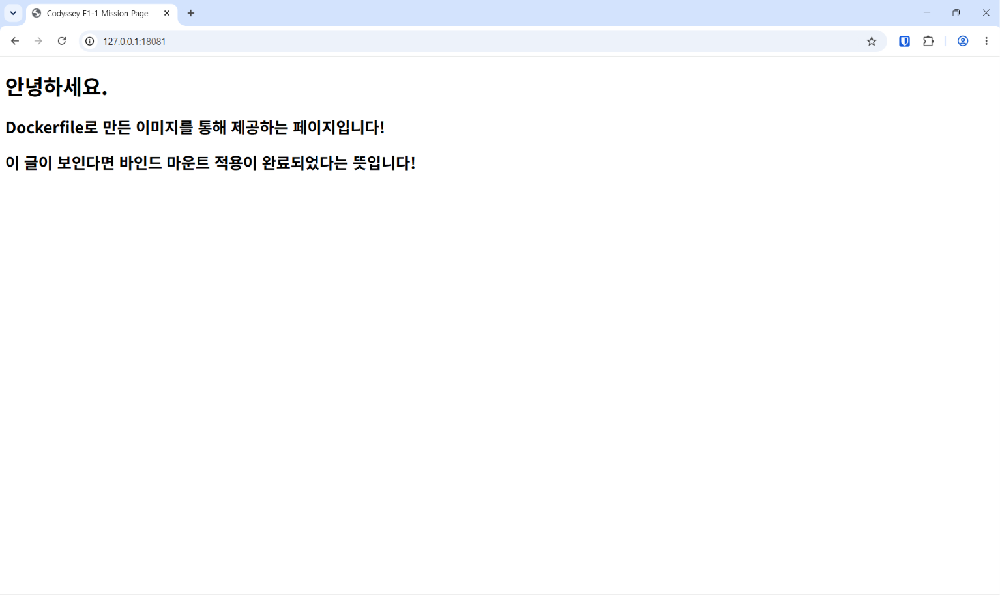

# 바인드 마운트 실행 및 파일 변경 로그

## 1. 바인드 마운트 구성

VM의 `site` 폴더를 컨테이너의 웹 문서 경로에 연결함.

| 항목 | 설정 |
| --- | --- |
| 컨테이너 | `e1-web-8081` |
| 이미지 | `e1-web:1.1` |
| VM 호스트 경로 | `~/Codyssey/Projects/E1-1/Docker/web/site` |
| 컨테이너 경로 | `/usr/share/nginx/html` |
| 포트 매핑 | VM `127.0.0.1:8081` → 컨테이너 `80` |
| 마운트 접근 권한 | 컨테이너에서 읽기 전용(`ro`) |

> 전환 과정에서 기존 컨테이너와의 이름 충돌로 오류가 발생했으며, 자세한 내용은 [트러블슈팅 사례 2](../99-TROUBLESHOOTING/TROUBLESHOOTING.md#사례-2)에 기술함.

<details>
<summary><h2>2. 기존 컨테이너 제거 및 바인드 마운트로 재생성</h2></summary>

```text
~/Codyssey/Projects/E1-1/Docker/web$ sudo docker stop e1-web-8081
e1-web-8081

~/Codyssey/Projects/E1-1/Docker/web$ sudo docker rm e1-web-8081
e1-web-8081

~/Codyssey/Projects/E1-1/Docker/web$ sudo docker run -d --name e1-web-8081 -p 127.0.0.1:8081:80 -v "$(pwd)/site:/usr/share/nginx/html:ro" e1-web:1.1
0f3406297b66a7cfcafdeb8958c0a3a8fef306b5f582503dec24e98bee8f7cfc
```

### 확인한 내용

- 기존 `e1-web-8081`을 중지하고 삭제함.
- 같은 이름으로 바인드 마운트 옵션을 적용하여 새 컨테이너를 생성·실행함.
- 새 컨테이너 ID가 출력됨.
- `$(pwd)/site`는 명령을 실행한 VM 작업 디렉토리 아래의 `site` 경로로 확장됨.
- `ro`는 컨테이너에서의 쓰기를 제한하며, VM에서 파일을 수정하는 것은 가능함.

</details>

<details>
<summary><h2>3. VM의 HTML 파일 수정</h2></summary>

```text
~/Codyssey/Projects/E1-1/Docker/web$ nano site/index.html

~/Codyssey/Projects/E1-1/Docker/web$ cat site/index.html
<!DOCTYPE html>
<html lang="ko">
<head>
  <meta charset="UTF-8">
  <title>Codyssey E1-1 Mission Page</title>
</head>
<body>
  <h1>안녕하세요.</h1>
  <h2>Dockerfile로 만든 이미지를 통해 제공하는 페이지입니다!</h2>
  <h2>이 글이 보인다면 바인드 마운트 적용이 완료되었다는 뜻입니다!</h2>
</body>
</html>
```

### 확인한 내용

- 컨테이너 생성 후 VM의 `site/index.html`을 수정함. index_bind.html로 첨부.
- 바인드 마운트 반영 여부를 구분할 수 있도록 새로운 문구를 추가함.
- `cat`으로 VM 파일에 추가 문구가 저장된 것을 확인함.

</details>

## 4. 변경 전후 비교 및 브라우저 확인

| 구분 | 페이지 내용 |
| --- | --- |
| 변경 전 | [포트 바인딩 문서 참고](Docker_Port.md#두-번째-접속) |
| 변경 후 | 기존 내용에 `이 글이 보인다면 바인드 마운트 적용이 완료되었다는 뜻입니다!` 문구 추가 |

<details>
<summary><h2>변경 후 화면 펼치기</h2></summary>



</details>

### 확인한 내용

- 바인드 마운트 컨테이너 실행 후 VM의 `site/index.html`을 수정함.
- 이미지 재빌드·컨테이너 재시작 없이 브라우저에서 추가 문구가 표시되는 것을 확인함.
- VM의 파일 변경이 바인드 마운트된 컨테이너의 웹페이지에 반영됨.
