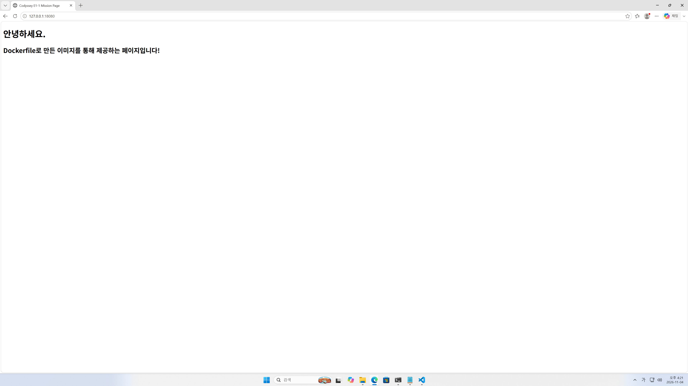
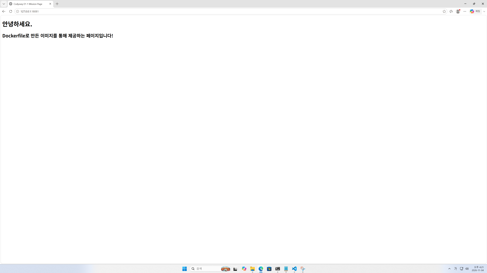

[← README로 돌아가기](../../README.md)

# 포트 매핑 및 접속 테스트 로그

## 1. 포트 매핑 구성

같은 웹 이미지로 컨테이너 두 개를 실행하고, 서로 다른 호스트 포트에 연결함.

| 컨테이너 | 이미지 | VM 호스트 포트 | 컨테이너 포트 |
| --- | --- | --- | --- |
| `e1-web-8080` | `e1-web:1.1` | `8080` | `80` |
| `e1-web-8081` | `e1-web:1.1` | `8081` | `80` |

> 실습 과정에서 한글 출력 깨짐이 발생했으며, 자세한 원인 확인 및 해결 과정은 [트러블슈팅 사례 1](../99-TROUBLESHOOTING/TROUBLESHOOTING.md#사례-1)에 기술함.

<details>
<summary><h2>2. 포트 매핑 컨테이너 실행</h2></summary>

```text
~/Codyssey/Projects/E1-1/Docker/web$ sudo docker run -d --name e1-web-8080 -p 127.0.0.1:8080:80 e1-web:1.1
e17075132e8ee2301f17f735ddc46fa7a606574b81613c0ec4a3d09c11411855

~/Codyssey/Projects/E1-1/Docker/web$ sudo docker run -d --name e1-web-8081 -p 127.0.0.1:8081:80 e1-web:1.1
f3e82867d8e3ccf1e78f7fbc619394abc05c1eca56c02d26ae58e91ffb01438b
```
</details>

## 3. 브라우저 접속 확인

PC에서는 SSH 터널을 통해 VM의 웹 서버에 접속함.

| 브라우저 접속 주소 | 연결된 VM 포트 |
| --- | --- |
| `http://127.0.0.1:18080/` | `8080` |
| `http://127.0.0.1:18081/` | `8081` |

### 첫 번째 접속

```text
http://127.0.0.1:18080/
```
<details>
  <summary><h2>사진 펼치기</h2></summary> 
  
  
</details>


### 두 번째 접속

```text
http://127.0.0.1:18081/
```

<details>
  <summary><h2>사진 펼치기</h2></summary> 
  
  
</details>
