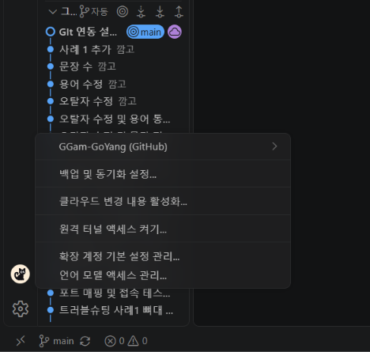
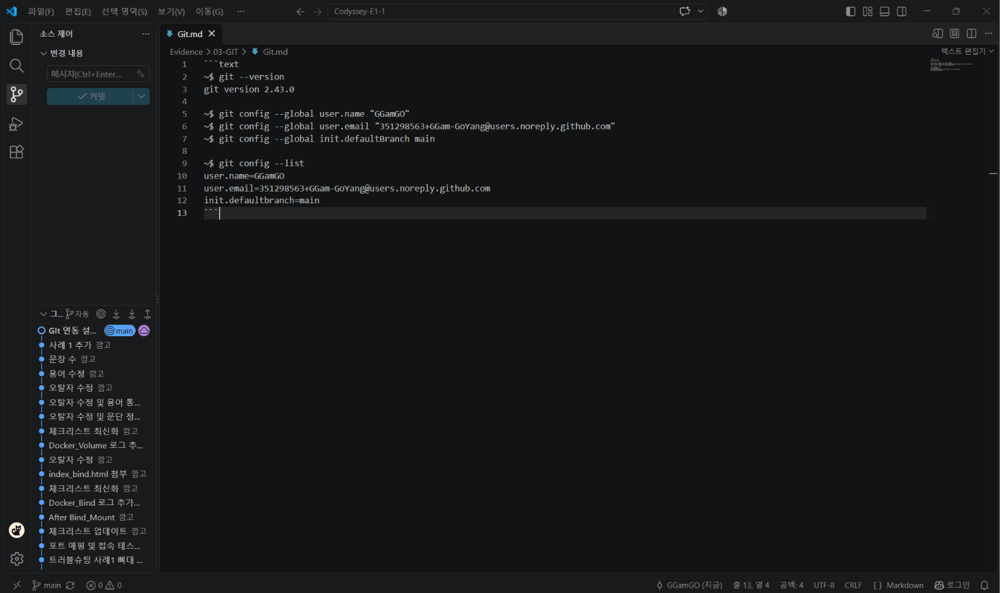

[← README로 돌아가기](../../README.md)

# Git 사용자 정보·기본 브랜치 설정 로그

## Git 사용자 정보·기본 브랜치 설정

```text
~$ git --version
git version 2.43.0

~$ git config --global user.name "GGamGO"                                          
~$ git config --global user.email "351298563+GGam-GoYang@users.noreply.github.com"
~$ git config --global init.defaultBranch main

~$ git config --list
user.name=GGamGO
user.email=351298563+GGam-GoYang@users.noreply.github.com
init.defaultbranch=main
```

## VSCode·GitHub 연동

### GitHub 로그인


### 커밋 및 원격 저장소 반영
